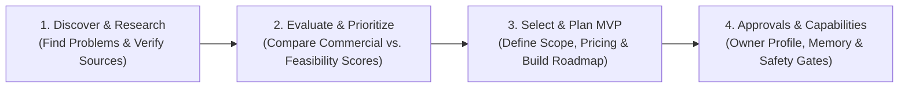

# STRAW V1.0 — Minimum Viable Product (MVP) Blueprint

**Date:** 2026-11-04  
**Product Name:** STRAW (Personal AI-Assisted Business Opportunity Discovery, Evaluation & MVP Planning System)  
**Target User:** Zak (Senior UX/UI Architect, Product Strategist, Figma & Design Systems Specialist, WordPress/HTML/CSS Builder using AI-Assisted Development)  
**Strategic Shift:** Stop endless platform expansion. Consolidate existing verified modules into a focused, trustworthy **V1.0 Opportunity Intelligence & MVP Planning System**.

---

## 1. Product Vision & Core Identity

STRAW is a **product entrepreneurship decision and planning system**. Its job in V1.0 is to help its owner answer two high-stakes business questions with intellectual honesty:
1. **"Which market problem is genuinely worth solving right now, given real evidence and my actual capabilities?"**
2. **"What is the smallest, commercially realistic digital product (MVP) I can plan and validate before investing weeks of build time?"**

### Core V1.0 End-to-End Workflow
```
DISCOVER  ──►  RESEARCH  ──►  EVALUATE  ──►  PRIORITIZE  ──►  SELECT  ──►  PLAN
(Problems)     (Verified      (Commercial    (Ranked          (Owner       (MVP Scope,
                Sources &      Demand vs.     Comparison &     Decision &   Pricing Hypothesis &
                Provenance)    Feasibility)   Rejections)      Gates)       Build Roadmap)
```

---

## 2. STRAW V1.0 Scope: Essential vs. Deferred Capabilities

We evaluated the 10 candidate capabilities against the existing codebase (`STRAW_CURRENT_CAPABILITY_AUDIT.md`) and Phase 8.1 audit findings (`PHASE8_1_INDEPENDENT_EVIDENCE_AUDIT.md`). Features are included in V1.0 **only** if they directly serve `DISCOVER -> RESEARCH -> EVALUATE -> PRIORITIZE -> SELECT -> PLAN`.

### 2.1 Essential Capabilities Included in STRAW V1.0

| # | V1.0 Capability | What It Does in V1.0 | Existing Code Reused | Adjustments Required Before V1.0 Release |
| :-: | :--- | :--- | :--- | :--- |
| **1** | **Multi-Source Opportunity Discovery (`DISCOVER`)** | Queries free public sources (Hacker News Algolia comments, WordPress.org Plugin Directory, GitHub Public Repos, and direct Public URLs/Pricing pages) or logs manual practitioner observations across all 15 digital product categories. | [`ResearchEngine.executeDiscoveryRun()`](file:///root/2026-portfolio/straw/src/engines/research-engine.js#L1732) | Fix batch Search API hash attribution so every repository/plugin records a distinct content hash; preserve trailing slashes on redirects. |
| **2** | **Traceable Evidence Collection & Provenance (`RESEARCH`)** | Stores every claim with an explicit tier (`verified_evidence`, `practitioner_observation`, `estimate`, `assumption`), HTTP status, retrieval timestamp, verbatim excerpt check, and 64-char SHA-256 content hash. | [`verifyAndClassifyEvidence()`](file:///root/2026-portfolio/straw/src/engines/research-engine.js#L825), [`safePublicFetch()`](file:///root/2026-portfolio/straw/src/engines/research-engine.js#L350) | Add JSON-LD `<script type="application/ld+json">` description extraction fallback so WordPress/schema.org pages verify cleanly. |
| **3** | **4-Way Commercial Evidence Separation (`RESEARCH -> EVALUATE`)** | Explicitly separates every opportunity's evidence into 4 buckets:<br>1. *Verified Problem Existence*<br>2. *Verified Market Demand*<br>3. *Verified Competitor Activity*<br>4. *Verified Willingness to Pay (`pricing` / buyer payment proof)* | [`analyzeOpportunityEvidenceQuality()`](file:///root/2026-portfolio/straw/src/engines/research-engine.js#L1369) | Extend evidence quality summary to count and display all 4 buckets distinctly so free plugins/GitHub stars are never mistaken for buyer payment proof. |
| **4** | **Dual-Lens Opportunity Evaluation (`EVALUATE`)** | Evaluates candidates across 11 dimensions grounded in the owner's 10 capabilities (`CapabilityEngine`), while reporting **Commercial Readiness Score** separately from **Technical & Capability Feasibility Score**. | [`scoreOpportunity()`](file:///root/2026-portfolio/straw/src/engines/scoring-engine.js#L69), [`CapabilityEngine`](file:///root/2026-portfolio/straw/src/engines/capability-engine.js) | Cap `demand_evidence` (`<= 5.0`), `monetization_potential` (`<= 5.5`), and `time_to_first_revenue` (`<= 5.0`) when `verified_willingness_to_pay_count === 0`, preventing supply-side buildability from inflating unvalidated ideas to `88/100`. |
| **5** | **Opportunity Ranking, Comparison & Anti-Repeat Memory (`PRIORITIZE`)** | Ranks all evaluated opportunities with side-by-side comparison of Overall Score, Commercial Readiness, Capability Fit, Verified Evidence Count, and Willingness-to-Pay Status, while blocking repeated rejected ideas. | [`OpportunityEngine.listOpportunities()`](file:///root/2026-portfolio/straw/src/engines/opportunity-engine.js#L35), [`IntelligenceEngine.checkRejectedIdeaOverlap()`](file:///root/2026-portfolio/straw/src/engines/intelligence-engine.js#L57) | Add Commercial vs. Feasibility sub-scores and WTP status badge directly to the comparison table. |
| **6** | **Auditable Opportunity Dossier & Recommendation Report (`PRIORITIZE`)** | Generates a clear, exportable Markdown/JSON report explaining why an idea is recommended for buyer validation (`CONDITIONAL_HOLD_VALIDATE_BUYERS`), approved, or rejected (`REJECT_WEAK_IDEA`), separating facts from assumptions. | [`exportOpportunityDossierMarkdown()`](file:///root/2026-portfolio/straw/src/engines/opportunity-engine.js#L198) | Include the 4-way evidence breakdown (Problem vs. Demand vs. Competitors vs. Willingness to Pay) and MVP plan summary in the exported Markdown dossier. |
| **7** | **Owner Selection & Product Concept Definition (`SELECT`)** | Allows the owner to select a top opportunity and define a concrete digital product concept (Product Name, Category, Target Buyer Persona, Core Problem Solved, and Differentiation Wedge). | [`ExecutionEngine.promoteOpportunityToProduct()`](file:///root/2026-portfolio/straw/src/engines/execution-engine.js#L149) | Reframe promotion in V1.0 as **"Generate MVP Concept & Build Plan"** (planning state) rather than launching straight into Stage 7 coding. |
| **8** | **MVP Feature Scope, Pricing Hypothesis & Validation Gate (`PLAN`)** | Defines the selected product's **V1 Must-Have Features**, **Explicitly Excluded Non-Goals**, **Pricing & Monetization Hypothesis**, and **Pre-Build Buyer Validation Criteria** (Build / Pivot / Abandon thresholds). | [`MONETIZATION_MODELS`](file:///root/2026-portfolio/straw/src/engines/growth-monetization-engine.js#L3), `products` table | Surface structured fields for MVP Must-Have Scope, Excluded Scope, Pricing Hypothesis, and Buyer Validation Checklist in the V1 Plan view. |
| **9** | **Milestone Development & Launch Roadmap (`PLAN`)** | Generates a realistic, AI-assisted development and launch roadmap grouped into clear phases and milestones with estimated effort hours, dependencies, and risks tailored to a non-programmer UX architect. | [`PRODUCT_LIFECYCLE_STAGES`](file:///root/2026-portfolio/straw/src/engines/execution-engine.js#L3), `product_tasks` table | Present as a clean **Read/Edit Milestone Blueprint** for V1.0 planning (deferring granular daily time-tracking to V2.0). |
| **10** | **Owner Approval & Financial Controls (`GOVERNANCE`)** | Enforces mandatory human sign-off (`ApprovalEngine`) before any paid API call, financial spend, customer contact, or public launch. | [`ApprovalEngine`](file:///root/2026-portfolio/straw/src/engines/approval-engine.js) | Already 100% implemented and verified; keep active across all V1.0 actions. |

---

### 2.2 Features Explicitly Deferred from STRAW V1.0

Even where code or database tables already exist from Phases 2–5, the following features are **excluded from the V1.0 user experience** so V1.0 remains simple, reliable, and focused on opportunity discovery and MVP planning:

| Deferred Feature / Subsystem | Current Repo Status | Deferred To | Why It Is Excluded from V1.0 |
| :--- | :--- | :---: | :--- |
| **Buyer Interview CRM, Outreach Scripts & Pilot Pre-Order Tracker** | Documented in Phase 8.1 report (`PHASE8_1_INDEPENDENT_EVIDENCE_AUDIT.md`) | **V1.5 (Commercial Validation)** | V1.0 identifies opportunities and generates the MVP & validation plan; V1.5 tracks actual buyer interview outcomes, pricing objections, and pilot commitments. |
| **Hypothetical Score Sensitivity Simulator Button (`Simulate +Verified Evidence`)** | Implemented in `opportunity-engine.js` & Tab 2 UI | **V1.5 (Commercial Validation)** | Simulating hypothetical verified evidence on unvalidated ideas encourages score-gaming instead of collecting real buyer proof. |
| **Interactive 15-Stage Task Time-Tracking & Active Build Operations** | Implemented in `execution-engine.js` & Tab 4 UI | **V2.0 (Product Execution)** | Tracking actual hours spent coding Stages 7–13 is premature until an opportunity passes commercial buyer validation. V1.0 only needs the **MVP Roadmap Plan**. |
| **Live External Paid LLM Provider SDK Calls (Gemini / OpenAI / Anthropic)** | Env-var placeholders in `ai-orchestrator.js` | **V2.0 (Product Execution)** | Local deterministic synthesis works at `$0` cost with zero API key setup or hallucination risk. |
| **Multi-Channel Growth Workspace, SEO Search-Intent Clusters & Playbooks** | Implemented in `growth-monetization-engine.js` & Tab 5 UI | **V3.0 (Growth & Automation)** | Planning programmatic SEO topic clusters and affiliate playbooks before a product is validated or built is classic scope creep. |
| **Post-Launch Performance Telemetry (`visitors`, `conversion_rate`, `CAC`, `LTV`)** | Implemented in `growth-monetization-engine.js` & Tab 5 UI | **V3.0 (Growth & Automation)** | Useless until a product is launched and generating traffic/revenue. |
| **Paid Keyword/Search Volume API (`paid_search_provider`) & OAuth Scrapers** | Marked `unsupported` in `research_sources` | **V3.0 (Growth & Automation)** | Requires paid API subscriptions (`DataForSEO`/`Brave`) or complex OAuth browser sessions unnecessary for V1.0 discovery. |

---

## 3. V1.0 User Journey (Designed for a Non-Technical Business Owner)

To eliminate tab-hopping across 7 fragmented panels, STRAW V1.0 streamlines the web interface into **4 clear, sequential workflow views** (plus a persistent header indicator for Owner Approval Gates):



### Step-by-Step V1.0 Owner Walkthrough

#### Step 1: Opening STRAW & Viewing the Priority Queue (`View 1 / Overview & Discovery`)
- **What the Owner Sees:** A clean executive summary showing:
  - How many opportunities have been discovered, how many are on **Conditional Hold for Buyer Validation**, and how many weak ideas were **Rejected**.
  - A simple **"Run Market Discovery"** bar where the owner enters a problem topic (e.g., *"WCAG 2.2 agency handoff"* or *"WooCommerce quote calculator"*) or pastes a specific competitor/discussion URL, selects a target product category, and clicks **Run Free Public Research**.
- **What STRAW Does Automatically:**
  - Queries selected free public connectors (`Hacker News Algolia`, `WordPress.org Plugin API`, `GitHub Public API`, or `Public URL Inspector`) through `safePublicFetch()`.
  - Verifies that every cited excerpt actually exists in the retrieved HTTP 200 source content, computes an individual 64-character SHA-256 content hash per item, blocks unsupported willingness-to-pay inferences, and tags each finding as:
    - `[VERIFIED EVIDENCE]` (HTTP 200 + excerpt confirmed in source)
    - `[PRACTITIONER OBSERVATION]` (valid URL or blocked `403` source requiring manual inspection)
    - `[ESTIMATE]` or `[ASSUMPTION]`

#### Step 2: Evaluating & Comparing Opportunities (`View 2: Evaluate & Prioritize`)
- **What the Owner Sees:**
  - A **Streamlined Quick-Add Opportunity Form** (requiring only 4 core inputs to start: *Title*, *Category*, *Problem Statement*, and *Target Buyer*, with advanced fields collapsible) so the owner never has to fill out 28 fields just to test an idea.
  - A **Ranked Opportunity Comparison Table** showing side-by-side:
    1. **Opportunity & Category**
    2. **Overall Score (`/100`)**
    3. **Commercial Readiness Sub-Score (`/10`)** vs. **Capability & Build Feasibility Sub-Score (`/10`)** (preventing easy-to-build ideas with `$0` demand from masquerading as top commercial winners)
    4. **4-Way Evidence Breakdown:** `Problem` | `Demand` | `Competitors` | `Willingness to Pay (WTP)`
    5. **Honest Recommendation Badge:**
       - `[READY FOR MVP PLAN]` (Verified problem + verified buyer WTP signal)
       - `[HOLD: VALIDATE BUYER WTP FIRST]` (Verified problem + high capability fit, but `0` verified buyer payment proof)
       - `[NEEDS VERIFIED EVIDENCE]` (`0` verified external sources)
       - `[REJECT WEAK IDEA]` (Severe capability mismatch, thin commodity wrapper, or refuted by free clones)
- **How Evidence & Uncertainty Are Communicated:**
  - Clicking any opportunity opens its **Auditable Opportunity Dossier**, which explicitly separates:
    - **What Is Proven (Facts & Verified Sources)**
    - **What Is Observed (Practitioner Signals & Free Substitutes)**
    - **What Is Still Assumed (Unverified Pricing & Conversion Hypotheses)**
  - The owner can click **Export Markdown Report** at any time to save a standalone dossier.

#### Step 3: Selecting an Opportunity & Generating the MVP Plan (`View 3: Select & Plan MVP`)
- **What the Owner Does:**
  - Reviews the top-ranked opportunity (e.g., `Sentinel A11y`), updates its status (`Approve for MVP Planning`, `Hold for Validation`, or `Reject Weak Idea` with a logged rejection reason so STRAW never repeats it), and clicks **Generate MVP Concept & Build Plan**.
- **What STRAW Generates & Presents:**
  1. **Product Concept Brief:** Product Name, Category, Target Customer Persona, Core Problem Solved, and Differentiation Wedge grounded in the owner's UX/Figma/WP/HTML/CSS strengths.
  2. **MVP Scope Boundary:**
     - **Must-Have V1 Features** (the smallest buildable product that solves the core problem in `<= 14` days via AI-assisted development).
     - **Explicitly Excluded Non-Goals** (features deferred so scope does not creep).
  3. **Pricing & Monetization Hypothesis:** Recommended model (e.g., One-Time Commercial License vs. Micro-SaaS Subscription), price band (`$49–$249`), tradeoffs, and **Pre-Build Buyer Validation Thresholds** (exact Build / Pivot / Abandon criteria before writing production code).
  4. **Milestone Development & Launch Roadmap:** A structured 6-Phase / 15-Stage milestone plan showing estimated effort hours, dependencies, acceptance criteria, and the mandatory Stage 14 Owner Launch Gate.

#### Step 4: Managing Owner Approvals & Capabilities (`View 4: Approvals & Capabilities`)
- **What the Owner Sees:**
  - **Pending Human Approval Gates:** Any action that spends money (`> $0`), calls a paid API, contacts customers, or launches a product publicly is held in a hard `PENDING` state until the owner clicks **Approve** or **Reject**.
  - **Owner Capability Profile & Institutional Memory:** The owner's 10 core skills and the log of past business decisions and rejected ideas.

---

## 4. Strict V1.0 Boundaries (Anti-Scope-Creep Charter)

To guarantee STRAW V1.0 ships cleanly and remains maintainable by a non-programmer owner:
1. **No Autonomous Product Coding:** STRAW V1.0 plans the MVP scope and roadmap; it does not autonomously spin up background code-generation agents to build external products.
2. **No Autonomous Customer Outreach:** STRAW V1.0 defines who to talk to and what questions to ask; it never sends emails, DMs, or posts to Reddit/Hacker News/LinkedIn.
3. **No Automated Spending or Purchases:** Every paid API source remains hard-locked behind `ApprovalEngine.verifyFinancialAuthorization()`, and V1.0 requires `$0` paid APIs to operate.
4. **No Complex Multi-Agent Swarms:** V1.0 uses one deterministic local synthesis layer (`AIOrchestrator`) with strict epistemic tagging (`AI_GENERATED_SYNTHESIS_NOT_SOURCE_EVIDENCE`).
5. **No Premature Marketing or Analytics Suites in the V1 UI:** Post-launch LTV/CAC calculators, visitor telemetry tables, and programmatic SEO cluster builders are hidden/deferred until V3.0.
6. **Zero Reduction in Security or Epistemic Safeguards:** SSRF defense (`safePublicFetch`), 64-character SHA-256 verification, willingness-to-pay over-inference blocking, and server-side financial approval checks are preserved at 100% strength.

---

## 5. Technical Debt & Phase 8.1 Defect Triage

We reviewed all technical defects identified during the Phase 8.1 audit and classified each by whether it must be fixed before calling STRAW V1.0 complete:

| Technical Issue / Defect | Location in Codebase | Classification | Reason for Classification & Required Fix |
| :--- | :--- | :---: | :--- |
| **1. Commercial Evidence Scoring Inflation (Conflating Problem Existence with Willingness to Pay)** | [`src/engines/scoring-engine.js`](file:///root/2026-portfolio/straw/src/engines/scoring-engine.js#L105-L176) | **CRITICAL BEFORE V1.0** | Currently, 1 verified record of a *free open-source competitor* unlocks a `9.2/10` Demand score and `88/100` overall score. V1.0's core promise is realistic commercial evaluation. Must separate **Commercial Readiness** from **Technical Feasibility** and cap `demand_evidence` / `monetization_potential` when `verified_willingness_to_pay_count === 0`. |
| **2. Shared Batch Search API SHA-256 Hash Attribution Defect** | [`src/engines/research-engine.js`](file:///root/2026-portfolio/straw/src/engines/research-engine.js#L2145), `#L2208` | **CRITICAL BEFORE V1.0** | `collectFromGitHubPublicApi()` and `collectFromWordPressPluginApi()` pass the shared batch Search API JSON (`rawText`) as `retrieved_source_content` for every item in the search results while setting `source_url` to each item's individual HTML URL, causing different repositories/plugins to have identical SHA-256 hashes. Must hash each item's canonical JSON payload + excerpt or fetch the individual page so every source record has an accurate, unique hash. |
| **3. 4-Way Evidence Bucket Separation (`Problem` vs `Demand` vs `Competitor` vs `WTP`)** | [`src/engines/research-engine.js`](file:///root/2026-portfolio/straw/src/engines/research-engine.js#L1369-L1466) | **CRITICAL BEFORE V1.0** | Required by V1.0 Capability #3 so the owner and scoring engine can see at a glance whether an opportunity has verified *Willingness to Pay* vs only *Problem* or *Competitor* evidence. |
| **4. Trailing-Slash Stripping 301 Redirect Loop** | [`src/engines/research-engine.js`](file:///root/2026-portfolio/straw/src/engines/research-engine.js#L648) | **IMPORTANT BEFORE V1.0** | `extractValidPublicUrl()` strips trailing slashes (`.replace(/\/$/, '')`), causing `safePublicFetch()` to loop on `301 Moved Permanently` when fetching canonical directory URLs like `https://www.w3.org/TR/WCAG22/` or `https://wordpress.org/plugins/dango-trackkar/`. A 3-line fix preserves path trailing slashes while keeping SSRF checks intact. |
| **5. JSON-LD `<script>` Stripping on WordPress/Schema HTML Pages** | [`src/engines/research-engine.js`](file:///root/2026-portfolio/straw/src/engines/research-engine.js#L661-L674) | **IMPORTANT BEFORE V1.0** | `normalizeTextForVerification()` strips all `<script>` blocks, including `<script type="application/ld+json">` where WordPress.org embeds plugin `short_description` text on HTML pages. Extracting text from `application/ld+json` before stripping executable scripts makes live HTML verification reliable. |
| **6. V1.0 UI Simplification (Consolidating 7 Tabs -> 4 V1 Views & Streamlining Intake Form)** | [`src/public/index.html`](file:///root/2026-portfolio/straw/src/public/index.html), [`src/public/app.js`](file:///root/2026-portfolio/straw/src/public/app.js) | **IMPORTANT BEFORE V1.0** | Hides premature V3.0 Growth/LTV telemetry tabs from V1.0 navigation, consolidates duplicate evidence tables, and adds sensible defaults to the New Opportunity form so a non-technical owner can use STRAW effortlessly. |
| **7. Unused `research_dossiers` Table vs `exportOpportunityDossierMarkdown()`** | [`src/engines/research-engine.js`](file:///root/2026-portfolio/straw/src/engines/research-engine.js#L2412) | **SAFE TO DEFER** | `exportOpportunityDossierMarkdown()` works cleanly and serves V1.0 exports. Leaving the `research_dossiers` table in SQLite causes zero harm and avoids unnecessary schema churn. |
| **8. Reddit Datacenter IP `403/429` Blocking & External Paid Search/LLM Providers** | [`src/engines/research-engine.js`](file:///root/2026-portfolio/straw/src/engines/research-engine.js#L2231), [`src/engines/ai-orchestrator.js`](file:///root/2026-portfolio/straw/src/engines/ai-orchestrator.js) | **SAFE TO DEFER** | Reddit blocks unauthenticated datacenter IPs by platform policy (manual URL/observation intake covers it), and external paid APIs are deferred to V2.0/V3.0. |

---

## 6. Project Management Plan to Complete STRAW V1.0

### 6.1 Honest Calculation of Current V1.0 Completion (`82.0%`)

We calculated current V1.0 completion across the **10 Core V1.0 Functional & Acceptance Modules** based strictly on verified working code (not documentation volume):

| V1.0 Core Module | Weight | Verified Points | Status & Remaining Work for 100% V1.0 |
| :--- | :---: | :---: | :--- |
| 1. SQLite Persistence & Schema Integrity | `10%` | **`10.0`** | `100%` complete & verified (`npm test`). |
| 2. Owner Profile & Capability Fit Engine | `10%` | **`10.0`** | `100%` complete & verified (`CapabilityEngine`). |
| 3. Public Research Connectors & SSRF Security | `12%` | **`9.5`** | `79%` — SSRF & 5 connectors work; needs per-item hash attribution fix (`M-V1.1`) and trailing-slash redirect fix (`M-V1.1`). |
| 4. Evidence Verification & Provenance Engine | `10%` | **`9.0`** | `90%` — HTTP 200 excerpt check & 64-char SHA-256 work; needs JSON-LD metadata extraction & 4-way bucket counters (`M-V1.1`). |
| 5. Commercial vs. Feasibility Scoring Engine | `14%` | **`7.0`** | `50%` — 11-dimension math works, but must separate Commercial Readiness from Technical Feasibility and gate unverified WTP scores (`M-V1.2`). |
| 6. Opportunity Ranking, Comparison & Anti-Repeat Memory | `10%` | **`9.0`** | `90%` — Ranking & anti-repeat work; needs Commercial vs. Feasibility sub-score columns in comparison output (`M-V1.2`). |
| 7. Auditable Opportunity Dossier & Report Exporter | `8%` | **`7.0`** | `87.5%` — Markdown/JSON export works; needs 4-way evidence summary & MVP plan section (`M-V1.2`). |
| 8. MVP Product Concept, Scope & Build Roadmap (`SELECT -> PLAN`) | `10%` | **`7.5`** | `75%` — Promotion & 15-stage roadmap exist; needs explicit MVP Must-Have vs. Excluded Scope fields & Pre-Build Validation Gate (`M-V1.3`). |
| 9. Owner Approval & Financial Authorization Controls | `8%` | **`8.0`** | `100%` complete & verified (`ApprovalEngine`). |
| 10. Focused Non-Technical V1 UI & Acceptance Test Suite | `8%` | **`5.0`** | `62.5%` — UI works, but needs 4-view V1 consolidation (hiding V3 telemetry bloat) and updated V1 acceptance tests (`M-V1.3`). |
| **TOTAL VERIFIED V1.0 COMPLETION** | **`100%`** | **`82.0%`** | **`18.0%` remaining (`11.5 hours` across 3 focused milestones)** |

---

### 6.2 Shortest Realistic Path to Complete STRAW V1.0 (`11.5 Hours` Total)

**Execution Rule:** After each milestone, run a focused acceptance check of **no more than 5 minutes** (`npm test` + targeted CLI/API verification). Proceed immediately when critical checks pass; log any non-critical polish items rather than looping tests indefinitely.

#### Phase V1-Final: Hardening & Simplifying Existing Codebase into STRAW V1.0

##### Milestone M-V1.1: Evidence Integrity, Per-Item Hashing & Redirect Fixes (`3.5 Hours`)
- **Goal:** Eliminate the Phase 8.1 extraction hash anomaly and redirect loop, and expose the 4-way commercial evidence breakdown (`Problem`, `Demand`, `Competitor`, `Willingness to Pay`).
- **Tasks:**
  1. **Task V1.1.1 — Fix Per-Item Source Content Hash Attribution in Batch Connectors**
     - *Priority:* **CRITICAL (P0)** | *Est. Effort:* `1.5h` | *Dependencies:* None
     - *Completion Criteria:* Two repositories returned by the same `collectFromGitHubPublicApi()` query (or two plugins from `collectFromWordPressPluginApi()`) produce distinct, deterministic 64-character SHA-256 `source_content_hash` values scoped to each individual item's canonical record.
     - *Expected Outcome:* Zero shared-hash anomalies across multi-item discovery runs.
     - *Risk:* Low (isolated to 2 functions in `src/engines/research-engine.js`).
  2. **Task V1.1.2 — Preserve Trailing Slashes in `extractValidPublicUrl()` & Extract JSON-LD Descriptions**
     - *Priority:* **HIGH (P1)** | *Est. Effort:* `1.0h` | *Dependencies:* None
     - *Completion Criteria:* `extractValidPublicUrl('https://www.w3.org/TR/WCAG22/')` preserves the trailing slash so `safePublicFetch()` does not hit a 301 redirect loop, and `normalizeTextForVerification()` preserves `application/ld+json` description text before stripping `<script>` tags.
     - *Expected Outcome:* Live URL verification succeeds on W3C and WordPress.org plugin pages on the first hop.
     - *Risk:* Low (must ensure SSRF hostname checks remain untouched).
  3. **Task V1.1.3 — Add 4-Way Evidence Bucket Classification (`Problem`, `Demand`, `Competitor`, `WTP`)**
     - *Priority:* **CRITICAL (P0)** | *Est. Effort:* `1.0h` | *Dependencies:* Task V1.1.1
     - *Completion Criteria:* `analyzeOpportunityEvidenceQuality()` returns explicit counts for `verified_problem_count`, `verified_demand_count`, `verified_competitor_count`, and `verified_willingness_to_pay_count`.
     - *Expected Outcome:* Clear programmatic distinction between problem existence and buyer payment proof.
     - *Risk:* Low.

##### Milestone M-V1.2: Realistic Commercial vs. Feasibility Scoring & Dossier Upgrade (`4.0 Hours`)
- **Goal:** Fix `scoring-engine.js` so technical feasibility and free competitor listings never masquerade as verified commercial willingness to pay.
- **Tasks:**
  1. **Task V1.2.1 — Separate `commercial_readiness_score` and `feasibility_score` in `scoreOpportunity()`**
     - *Priority:* **CRITICAL (P0)** | *Est. Effort:* `2.0h` | *Dependencies:* Task V1.1.3
     - *Completion Criteria:* When `verified_willingness_to_pay_count === 0`, `demand_evidence` is capped at `<= 5.0/10`, `monetization_potential` at `<= 5.5/10`, and `time_to_first_revenue` at `<= 5.0/10`, and the recommendation outputs `CONDITIONAL_HOLD_VALIDATE_BUYERS` instead of inflating scores to `86–88/100`. Returns both `commercial_readiness_score` (`0–100`) and `technical_feasibility_score` (`0–100`).
     - *Expected Outcome:* Scores match the realistic Phase 8.1 audited commercial posture.
     - *Risk:* Moderate (existing unit test assertions in `tests/straw.test.js` must be updated to match the stricter commercial scoring thresholds).
  2. **Task V1.2.2 — Upgrade Opportunity Dossier Export with 4-Way Evidence & MVP Plan Summary**
     - *Priority:* **HIGH (P1)** | *Est. Effort:* `2.0h` | *Dependencies:* Task V1.2.1
     - *Completion Criteria:* `exportOpportunityDossierMarkdown()` includes (a) Commercial Readiness vs. Technical Feasibility sub-scores, (b) the 4-way evidence breakdown table, (c) explicit separation of verified facts vs. unverified commercial projections, and (d) the MVP Concept & Validation Plan if defined.
     - *Expected Outcome:* Every exported opportunity report meets institutional audit standards.
     - *Risk:* Low.

##### Milestone M-V1.3: Focused 4-View V1 Workspace & MVP Plan Refinements (`4.0 Hours`)
- **Goal:** Streamline the UI around `DISCOVER -> RESEARCH -> EVALUATE -> PRIORITIZE -> SELECT -> PLAN` and lock V1.0 acceptance tests.
- **Tasks:**
  1. **Task V1.3.1 — Streamline UI Navigation into 4 Focused V1 Views & Simplify Opportunity Intake**
     - *Priority:* **HIGH (P1)** | *Est. Effort:* `2.0h` | *Dependencies:* Task V1.2.1
     - *Completion Criteria:* Main navigation presents the 4 V1.0 workflow views (`1. Discover & Research`, `2. Evaluate & Compare`, `3. Select & Plan MVP`, `4. Approvals & Capabilities`); hides premature V3.0 Growth/LTV telemetry tabs and the hypothetical score simulator button; simplifies the New Opportunity intake form with collapsible advanced sliders.
     - *Expected Outcome:* A clean, non-overwhelming workspace for a non-technical business owner.
     - *Risk:* Low (preserves all backend APIs so V2.0/V3.0 features are not deleted).
  2. **Task V1.3.2 — Enhance `SELECT -> PLAN` View with MVP Scope, Pricing Hypothesis & Validation Gate**
     - *Priority:* **HIGH (P1)** | *Est. Effort:* `1.0h` | *Dependencies:* Task V1.3.1
     - *Completion Criteria:* Promoting/selecting an opportunity generates a structured **MVP Concept & Build Plan** containing Target Audience, Must-Have V1 Scope, Excluded Non-Goals, Pricing Hypothesis, Build/Pivot/Abandon Validation Criteria, and the Milestone Build Roadmap.
     - *Expected Outcome:* Complete end-to-end `DISCOVER -> PLAN` output for any selected opportunity.
     - *Risk:* Low.
  3. **Task V1.3.3 — Final V1.0 Acceptance Test Suite & <=5-Minute Verification Gate**
     - *Priority:* **CRITICAL (P0)** | *Est. Effort:* `1.0h` | *Dependencies:* Tasks V1.1.1–V1.3.2
     - *Completion Criteria:* `npm test` passes all offline unit/integration/security/scoring tests in `< 5 seconds`, and all 10 criteria in `STRAW_V1_ACCEPTANCE_CRITERIA.md` are verified.
     - *Expected Outcome:* STRAW V1.0 is complete, verified, and ready for daily use.
     - *Risk:* Low.
