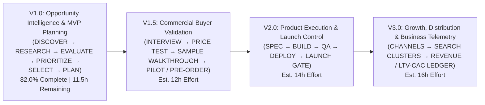

# STRAW — Versioned Release Strategy & Product Roadmap (`V1.0` to `V3.0`)

**Date:** 2026-11-04  
**Repository:** `https://github.com/zakshub/straw` (`/root/2026-portfolio/straw`)  
**Guiding Principle:** Every release must be independently useful and self-contained. `V1.0` does **not** depend on `V1.5`, `V2.0`, or `V3.0` to deliver a complete opportunity discovery, evaluation, and MVP planning workflow.

---

## Release Architecture Overview

---

## 1. Release `V1.0`: Opportunity Intelligence & MVP Planning (Current Target)

| Dimension | Specification |
| :--- | :--- |
| **Product Objective** | Turn STRAW's existing codebase into a reliable, daily-driver **Opportunity Intelligence & MVP Planning System** that helps the owner discover real market problems, verify source evidence without commercial score inflation, compare opportunities honestly, and generate a practical MVP Concept & Build Roadmap for a selected opportunity. |
| **Target User Outcome** | The owner can open STRAW, investigate a market topic across free public sources, see clearly whether an idea has verified problem existence vs. verified buyer willingness to pay, compare ranked candidates across Commercial Readiness and Capability Fit, reject weak ideas with institutional memory, and export an actionable MVP Concept & Milestone Plan—without writing code or spending money. |
| **Core Features** | 1. **Multi-Source Public Discovery (`DISCOVER`):** Free public connectors (`hn_algolia_api`, `wordpress_plugins_api`, `github_repos_api`, `public_url_inspector`) + manual observation/URL intake across 15 product categories. 2. **Traceable Content Verification (`RESEARCH`):** HTTP 200 excerpt verification, per-item 64-character SHA-256 `source_content_hash`, trailing-slash & JSON-LD handling, and SSRF protection (`safePublicFetch`). 3. **4-Way Commercial Evidence Separation (`RESEARCH -> EVALUATE`):** Explicit separation of *Verified Problem Existence*, *Verified Market Demand*, *Verified Competitor Activity*, and *Verified Willingness to Pay*. 4. **Dual-Lens Opportunity Evaluation (`EVALUATE`):** 11-dimension scoring grounded in the owner's 10 capabilities (`CapabilityEngine`), reporting **Commercial Readiness Score** separately from **Technical Feasibility Score** and capping unverified WTP claims. 5. **Ranked Comparison & Anti-Repeat Memory (`PRIORITIZE`):** Side-by-side opportunity ranking, structured competitor matrix, and automatic overlap warnings against previously rejected ideas. 6. **Auditable Opportunity Dossier Report (`PRIORITIZE`):** 1-click Markdown/JSON dossier export separating verified facts, practitioner observations, and unverified projections. 7. **MVP Concept, Scope & Build Roadmap (`SELECT -> PLAN`):** Defines Target Buyer, Must-Have V1 Features, Excluded Non-Goals, Pricing & Monetization Hypothesis, Build/Pivot/Abandon Validation Thresholds, and a 6-Phase Milestone Build Plan. 8. **Mandatory Owner Approval & Financial Controls (`GOVERNANCE`):** Server-side single-use scoped financial approval verification (`ApprovalEngine`) blocking any unauthorized spend or external action. |
| **Features Explicitly Excluded** | • Live buyer outreach / interview CRM tracking (deferred to `V1.5`) • Hypothetical score sensitivity simulator button in main UI (deferred to `V1.5`) • Active day-by-day 15-stage software build time tracking (deferred to `V2.0`) • External paid LLM SDK integrations (`Gemini`/`OpenAI`/`Anthropic` live calls — deferred to `V2.0`) • Multi-channel marketing playbooks, SEO search-intent cluster manager, and post-launch visitor/LTV/CAC telemetry (deferred to `V3.0`) • Paid search volume APIs (`DataForSEO`/`Brave Paid` — deferred to `V3.0`) |
| **Dependencies** | None external. Runs 100% on local Node.js (`v26.3.1`) with built-in `node:sqlite`, `node:http`, and `node:test`. |
| **Technical Requirements** | • Fix batch Search API SHA-256 hash attribution in `collectFromGitHubPublicApi()` and `collectFromWordPressPluginApi()` (`M-V1.1`). • Fix trailing-slash redirect stripping in `extractValidPublicUrl()` and preserve JSON-LD descriptions in `normalizeTextForVerification()` (`M-V1.1`). • Separate Commercial Readiness from Technical Feasibility in `scoreOpportunity()` and gate `demand_evidence` / `monetization_potential` on verified WTP (`M-V1.2`). • Consolidate the frontend UI into 4 focused V1 views (`M-V1.3`). |
| **Acceptance Criteria** | Must pass all 10 objective criteria defined in [`STRAW_V1_ACCEPTANCE_CRITERIA.md`](./STRAW_V1_ACCEPTANCE_CRITERIA.md), verified via `npm test` (offline deterministic suite) and `npm run audit:db`. |
| **Estimated Development Effort** | **`82.0%` already implemented and verified.** **`11.5 hours` remaining** across 3 focused milestones (`M-V1.1`: `3.5h`, `M-V1.2`: `4.0h`, `M-V1.3`: `4.0h`). |
| **Expected Business Value** | Immediately prevents the owner from wasting weeks building unvalidated or free-commodity products (such as `ContrastPair OKLCH` or a WooCommerce-only `PakCOD Shield`), while producing a clear, evidence-backed MVP blueprint for top candidates (`Sentinel A11y` / `AuditReady EAA`). |
| **Risks & Assumptions** | • *Risk:* Free public APIs (GitHub, Reddit) enforce rate limits or block datacenter IPs (`403/429`). *Mitigation:* V1.0 handles `403/429` gracefully by logging `pending_review` manual inspection records without crashing. • *Assumption:* Software completion of `V1.0` proves **system readiness**, not **commercial market validation** of any individual opportunity. |

---

## 2. Release `V1.5`: Commercial Buyer Validation

| Dimension | Specification |
| :--- | :--- |
| **Product Objective** | Equip the owner to execute structured **pre-build commercial validation** (buyer discovery interviews, pricing anchor checks, 1-page sample walkthroughs, and paid pilot/pre-order commitment tracking) before committing to full product development. |
| **Target User Outcome** | The owner can take an opportunity held at `CONDITIONAL_HOLD_VALIDATE_BUYERS` in `V1.0`, generate an owner-approved Buyer Discovery Interview Script & 1-Page Sample Brief, log real buyer conversations and pricing responses, and automatically unlock `APPROVED_FOR_BUILD`, `PIVOT_REQUIRED`, or `ABANDON_IDEA` based on real commercial thresholds. |
| **Core Features** | 1. **Buyer Validation Experiment Tracker:** Structured ledger per opportunity to log target buyer segments (e.g., UX Agencies vs. SaaS Teams), interview notes, current paid tools used by interviewees, and budget authority. 2. **Pricing & Willingness-to-Pay Signal Logger:** Dedicated intake for binding commercial signals (specific pricing inquiries, paid pilot requests, refundable pre-order deposits) that convert `verified_willingness_to_pay_count` from `0` to `>= 1`. 3. **Automated Build / Pivot / Abandon Gate:** Evaluates logged buyer conversations against the opportunity's pre-set decision thresholds (e.g., `>= 3/10` paid pilot requests = `BUILD`; `0/10` budget authority = `ABANDON`). 4. **Owner-Approved Outreach & Interview Script Generator:** Generates non-pitching discovery questions and a 1-page sample scope brief—strictly gated by an `ApprovalEngine` checkpoint (`contact_customers`) before any external communication occurs. 5. **Real-Data Sensitivity Simulator:** Re-enables `simulateOpportunityScore()` tied to actual buyer validation milestones rather than hypothetical guesses. |
| **Features Explicitly Excluded** | • Automated cold emailing, LinkedIn scraping, or autonomous DM bots (strictly forbidden). • Unapproved collection of customer payments without explicit owner authorization. • Full 15-stage software code execution tracking (`V2.0`) and post-launch SEO/analytics suites (`V3.0`). |
| **Dependencies** | Requires `V1.0` (specifically the 4-way evidence separation and Commercial Readiness scoring gates). |
| **Technical Requirements** | • Add `validation_experiments` and `buyer_interviews` tables (or structured `market_evidence` `pricing` extensions) in `src/db/database.js`. • Wire `ApprovalEngine` `contact_customers` gate to validation campaign activation. • Update `scoreOpportunity()` to automatically promote `CONDITIONAL_HOLD_VALIDATE_BUYERS` -> `APPROVED_FOR_EXECUTION` when verified buyer pilot/WTP thresholds are met. |
| **Acceptance Criteria** | 1. Logging 3 verified buyer pilot/pricing commitments updates `verified_willingness_to_pay_count` and unlocks the commercial readiness cap. 2. Logging 10 buyer interviews with `0` willingness to pay automatically recommends `ABANDON` or `PIVOT` and records the lesson in `business_intelligence_log`. 3. No external customer contact protocol can be marked active without an approved `contact_customers` record in `approval_requests`. |
| **Estimated Development Effort** | **`12.0 hours`** across 3 milestones (`4h` data model & validation gate logic, `5h` Buyer Validation UI panel & interview script generator, `3h` automated tests). |
| **Expected Business Value** | Replaces vanity validation metrics (free downloads, waitlist emails) with real commercial proof, ensuring the owner only builds products that buyers have already offered to pay for. |
| **Risks & Assumptions** | • *Risk:* Low response rates when reaching out to busy agency directors or SaaS leads. *Mitigation:* Focus on warm practitioner communities, teardowns, and concise 4-question discovery conversations. |

---

## 3. Release `V2.0`: Product Execution & Launch Control

| Dimension | Specification |
| :--- | :--- |
| **Product Objective** | Guide the owner through **building, testing, packaging, and launching** a commercially validated digital product (Figma system, WordPress plugin, browser utility, or Micro-SaaS) using structured AI-assisted development workflows. |
| **Target User Outcome** | Once an opportunity passes `V1.5` commercial validation, the owner activates the full **15-Stage Product Execution Workspace**, tracks real task-effort completion across UX architecture, token/code implementation, QA, and deployment, and executes a controlled public release through the Stage 14 Owner Launch Gate. |
| **Core Features** | 1. **Full Interactive 15-Stage Execution Workspace (Re-activated from existing codebase):** Task status controls (`todo`, `in_progress`, `blocked`, `done`), actual vs. estimated hours tracking, and real effort-weighted completion percentage (`ExecutionEngine`). 2. **Stage-Order Dependency Diagnostics & Critical Path Alerts:** Warns when foundational stages (e.g., Stage 2 Market Validation or Stage 6 UX Architecture) are skipped while Stage 11 Implementation is active. 3. **AI-Assisted Build Prompt & Spec Pack Generator:** Translates the approved MVP scope and UX architecture notes into modular implementation prompts and acceptance checklists tailored for coding agents. 4. **Optional External LLM Provider Adapter (`AIOrchestrator`):** Enables optional, owner-authorized API key connection (`Gemini`, `OpenAI`, or `Anthropic`) with strict per-call budget limits for drafting product copy or documentation. 5. **Mandatory Stage 14 Public Launch Approval Gate:** Automatically locks product status at `launch_gated` upon completing Stage 14 until the owner explicitly approves `launch_product` in `ApprovalEngine`. |
| **Features Explicitly Excluded** | • Unsupervised autonomous deployment to production servers without owner sign-off. • Post-launch paid ad management and multi-period LTV/CAC cohorts (`V3.0`). |
| **Dependencies** | Requires `V1.0` MVP Plan structure and `V1.5` Commercial Validation sign-off (note: `80%+` of the `V2.0` backend engine in `src/engines/execution-engine.js` is already implemented in the repository and preserved for this release). |
| **Technical Requirements** | • Re-expose the interactive 15-Stage Execution Workspace tab for opportunities that have achieved `approved` status. • Add modular AI-assisted build spec export (`GET /api/products/:id/build-spec`). • Wire optional LLM API adapter behind `ApprovalEngine.verifyFinancialAuthorization()`. |
| **Acceptance Criteria** | 1. Only commercially validated/owner-approved opportunities can enter active Stage 7–15 build tracking. 2. Product completion percentage reflects actual completed task effort hours (`0%` to `100%`). 3. Completing Stage 14 triggers a `pending` `launch_product` approval gate that blocks `launched` status until approved by the owner. |
| **Estimated Development Effort** | **`14.0 hours`** (low effort because `src/engines/execution-engine.js` is already built and tested; work focuses on V1.5-to-V2.0 gating, AI build-spec export, and optional LLM adapter wiring). |
| **Expected Business Value** | Keeps AI-assisted product development disciplined, prevents mid-build scope creep, and ensures every launched asset meets UX/WCAG 2.2 quality standards. |
| **Risks & Assumptions** | • *Risk:* Technical scope creep during Stage 11 (Implementation) for a non-programmer owner. *Mitigation:* Enforce the `<= 14 day` V1 wedge constraint and lean on the owner's Level-5 Figma, UX/IA, WordPress, and HTML/CSS strengths. |

---

## 4. Release `V3.0`: Growth, Distribution & Business Automation

| Dimension | Specification |
| :--- | :--- |
| **Product Objective** | Help the owner **acquire customers, track real revenue and unit economics, and compound portfolio intelligence** across launched digital products. |
| **Target User Outcome** | After launching a product in `V2.0`, the owner uses STRAW to execute organic distribution playbooks (directories, search-intent utilities, practitioner communities), track honest revenue/operating costs/LTV:CAC telemetry, and feed real launch outcomes back into future opportunity scoring. |
| **Core Features** | 1. **Multi-Channel Distribution Workspace (Re-activated from `growth-monetization-engine.js`):** Recommends and tracks acquisition channels matched to product category (Ecosystem Marketplaces, Search Intent, Communities, Content Teardowns, Email, Affiliates, and Approval-Gated Paid Ads). 2. **Search-Intent & Conversion Asset Cluster Planner:** Maps bottom-of-funnel query patterns (`tool_utility`, `compliance_checklist`, `comparison_alternative`) to free lead-magnet utilities or landing pages. 3. **Honest Performance & Unit Economics Ledger:** Tracks real periodic `visitors`, `conversion_rate_pct`, `revenue_usd`, `operating_cost_usd`, `net_cashflow_usd`, `LTV:CAC`, and break-even units (`NO_METRICS_RECORDED` until real data is entered—never fabricated). 4. **Optional Paid Search & Keyword Volume Connector (`paid_search_provider`):** Integrates paid keyword/trend APIs (`DataForSEO` / `Brave Paid`) strictly gated by single-use scoped `ApprovalEngine` financial authorizations. 5. **Closed-Loop Portfolio Intelligence:** Feeds actual product revenue and conversion rates back into `IntelligenceEngine` to calibrate future opportunity scoring weights. |
| **Features Explicitly Excluded** | • Autonomous social media auto-posting or spam bots. • Unapproved ad spend or automatic budget increases. |
| **Dependencies** | Requires at least one launched product from `V2.0` (note: core backend logic in `src/engines/growth-monetization-engine.js` is already implemented in the repository and preserved for `V3.0`). |
| **Technical Requirements** | • Re-enable the Growth & Monetization Workspace (`Tab 5`) for products in `launched` status. • Implement optional CSV/webhook import for Stripe/Gumroad/LemonSqueezy revenue ledger entries (`verified_integration` provenance). • Implement the optional `paid_search_provider` HTTP adapter behind `verifyFinancialAuthorization()`. |
| **Acceptance Criteria** | 1. Paid acquisition channels (`cost > $0` or `paid_advertising`) automatically remain locked in `gated_approval` status until the owner approves the exact dollar commitment. 2. Unit economics calculator reports `INSUFFICIENT_VERIFIED_DATA` when LTV/CAC inputs are absent and computes accurate net cashflow and break-even units when ledger rows exist. 3. Post-launch lessons learned update the portfolio recommendation engine. |
| **Estimated Development Effort** | **`16.0 hours`** (`6h` already built in `growth-monetization-engine.js`; `10h` for payment ledger import, paid search adapter, and closed-loop portfolio feedback). |
| **Expected Business Value** | Turns a single launched digital product into a repeatable, cash-flowing portfolio with honest financial accounting and zero wasted ad spend. |
| **Risks & Assumptions** | • *Risk:* Relying on a single acquisition channel (e.g., SEO alone). *Mitigation:* `GrowthMonetizationEngine` enforces multi-channel distribution across ecosystem marketplaces, communities, and high-intent tools. |
